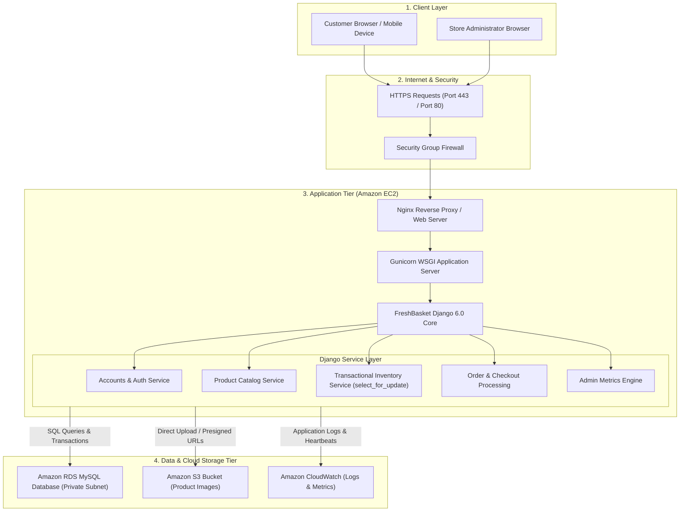
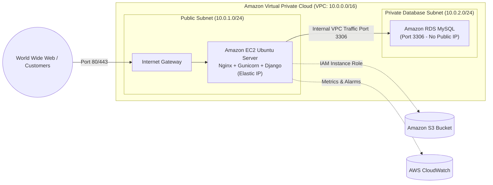
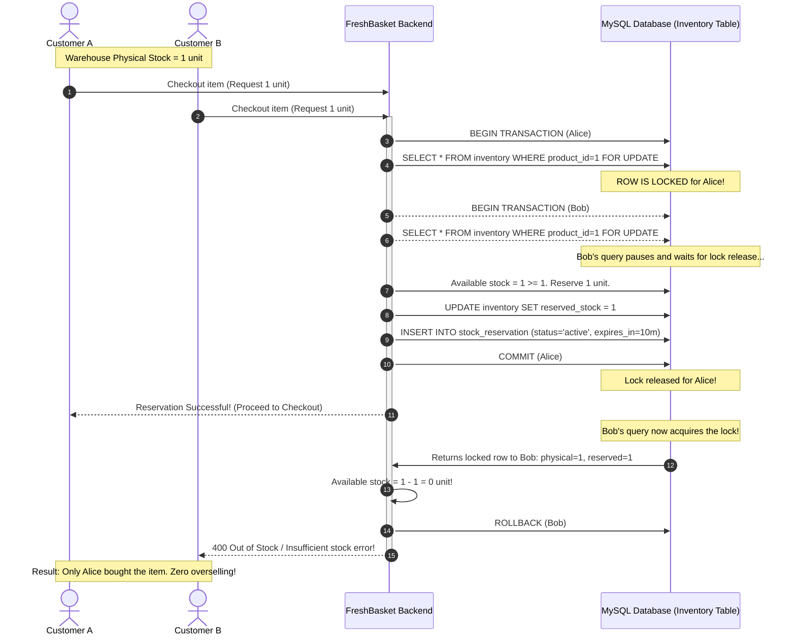

# FreshBasket System & AWS Cloud Architecture

**FreshBasket: Design and Development of a Scalable Cloud-Based Grocery Ordering and Inventory-Consistency Management System Using Amazon Web Services**

---

## 1. Architectural Overview

FreshBasket follows a modern **three-tier web architecture**:

1. **Presentation Tier (Frontend):** HTML5, CSS3, Bootstrap 5, responsive layouts, dynamic stock badges, and Chart.js dashboards.
2. **Application Tier (Backend):** Python 3.13, Django 6.0, Django ORM, custom authentication, and transaction-safe inventory reservation services.
3. **Data Tier (Storage & Cloud):** MySQL (or Amazon RDS MySQL) for relational transactional data, and Amazon S3 for cloud object storage.

---

## 2. High-Level System Architecture Diagram

---

## 3. AWS Cloud Network Infrastructure (VPC & Subnets)

To ensure enterprise-grade security and intermediate college-level cloud best practices:
- The **Amazon EC2 application server** is placed inside a **Public Subnet** with an Internet Gateway so that shoppers can visit the website.
- The **Amazon RDS MySQL database** is placed inside an isolated **Private Subnet** with **NO direct Internet access**. It only accepts incoming traffic on port 3306 from the EC2 security group.

---

## 4. Concurrency & Transactional Flow (MVP 1 Core Innovation)

The central innovation of FreshBasket is preventing inventory overselling. The sequence diagram below demonstrates how `select_for_update()` serializes concurrent requests to maintain inventory consistency:

---

## 5. Security Architecture

1. **Role-Based Access Control (RBAC):** Custom `User` model with strict separation between `customer` and `admin` roles, enforced via `@require_admin` decorators on all management views.
2. **Safe Credential Management:** Zero hardcoded keys. Database credentials, Django secrets, and AWS region configurations are read from `.env` via `python-dotenv`.
3. **Database Injection Protection:** 100% of queries use Django ORM parameterized queries; raw SQL concatenation is strictly forbidden.
4. **Cross-Site Request Forgery (CSRF):** Form tokens validated on every `POST` request.
5. **Session Isolation:** HTTP-only cookies and automatic session timeouts protect customer privacy.

