# FreshBasket Database Architecture & ER Diagram

FreshBasket uses a relational schema designed for **MySQL** in local development and **Amazon RDS MySQL** in production.

---

## 1. Entity-Relationship (ER) Diagram

```mermaid
erDiagram
    USER ||--o{ ADDRESS : "has saved"
    USER ||--o| CART : "owns"
    USER ||--o{ ORDER : "places"
    USER ||--o{ STOCK_RESERVATION : "makes"
    USER ||--o{ INVENTORY_LOG : "performs"

    CATEGORY ||--o{ PRODUCT : "classifies"
    PRODUCT ||--o| INVENTORY : "tracked by"
    PRODUCT ||--o{ CART_ITEM : "added to"
    PRODUCT ||--o{ ORDER_ITEM : "purchased in"
    PRODUCT ||--o{ STOCK_RESERVATION : "reserved in"
    PRODUCT ||--o{ STOCK_ALERT : "triggers"
    PRODUCT ||--o{ INVENTORY_LOG : "audited in"

    SUBSTITUTE_GROUP ||--o{ SUBSTITUTE_GROUP_ITEM : "contains"
    PRODUCT ||--o{ SUBSTITUTE_GROUP_ITEM : "is substitute member"

    CART ||--o{ CART_ITEM : "contains"
    ORDER ||--o{ ORDER_ITEM : "contains"
    ORDER ||--o| PAYMENT : "settled by"
    ORDER ||--o{ INVENTORY_LOG : "references"

    USER {
        int id PK
        string username UK
        string email
        string role "customer | admin"
        string phone
        datetime date_joined
    }

    ADDRESS {
        int id PK
        int user_id FK
        string label "home | work | other"
        string full_name
        string phone
        string address_line1
        string city
        string state
        string pincode
        boolean is_default
    }

    CATEGORY {
        int id PK
        string name UK
        string slug UK
        string icon
        boolean is_active
        int sort_order
    }

    PRODUCT {
        int id PK
        int category_id FK
        string name
        string slug UK
        decimal price
        string unit "kg | g | L | ml | pcs | dozen | pack"
        decimal unit_quantity
        int low_stock_threshold
        boolean is_active
        boolean is_featured
    }

    INVENTORY {
        int id PK
        int product_id FK,UK
        int physical_stock
        int reserved_stock
        string stock_status "in_stock | low_stock | out_of_stock"
        datetime last_restocked_at
        datetime updated_at
    }

    STOCK_RESERVATION {
        int id PK
        int user_id FK
        int product_id FK
        int quantity
        string status "active | confirmed | expired | cancelled"
        datetime expires_at
        datetime created_at
    }

    STOCK_ALERT {
        int id PK
        int product_id FK
        string alert_type "low_stock | out_of_stock"
        int stock_level_at_alert
        boolean is_acknowledged
        int acknowledged_by_id FK
        datetime created_at
    }

    INVENTORY_LOG {
        int id PK
        int product_id FK
        string change_type "restock | sale | reservation | release | cancellation"
        int quantity_changed
        int previous_physical_stock
        int new_physical_stock
        int previous_reserved_stock
        int new_reserved_stock
        int performed_by_id FK
        string reason
        int reference_order_id FK
        datetime timestamp
    }

    CART {
        int id PK
        int user_id FK,UK
        datetime updated_at
    }

    CART_ITEM {
        int id PK
        int cart_id FK
        int product_id FK
        int quantity
        string substitution_preference "none | allow | specific"
        int specific_substitute_id FK
    }

    ORDER {
        int id PK
        string order_number UK
        int user_id FK
        string status "pending | confirmed | processing | out_for_delivery | delivered | cancelled"
        string payment_method "cod | simulated"
        decimal subtotal
        decimal delivery_fee
        decimal total_amount
        string delivery_full_name
        string delivery_phone
        string delivery_address_line1
        string delivery_city
        string delivery_pincode
        datetime created_at
    }

    ORDER_ITEM {
        int id PK
        int order_id FK
        int product_id FK
        string product_name
        decimal product_price
        int quantity
        string substitution_preference
        int substitute_product_id FK
        string substitute_name
        decimal substitute_price
    }

    PAYMENT {
        int id PK
        int order_id FK,UK
        decimal amount
        string method
        string status
        datetime created_at
    }
```

---

## 2. Table Descriptions & Business Rules

### 1. `auth_user_extended` (User)
- Extends standard Django `AbstractUser`.
- `role`: Can be `customer` or `admin`.
- `phone`: Mobile phone used for delivery notifications.

### 2. `product` & `product_category`
- Hierarchical classification of grocery items.
- Products snapshot their `low_stock_threshold` to dynamically trigger alerts.
- Slugified URLs (`/products/amul-milk/`) ensure SEO-friendly routing.

### 3. `inventory` (The Core Inventory Tracker)
- **1-to-1 relationship** with `product`.
- `physical_stock`: Total units sitting in the store.
- `reserved_stock`: Units temporarily held by shoppers in active checkout sessions.
- Calculated property: `available_stock = physical_stock - reserved_stock`.
- `stock_status` is automatically recalculated before every database save.

### 4. `stock_reservation` (Temporary Locks)
- Prevents overselling when multiple shoppers want limited stock.
- Automatically times out after 10 minutes (`expires_at`), releasing the units back to `available_stock`.

### 5. `inventory_log` (Permanent Audit Ledger)
- Strict append-only ledger.
- Administrator interface disables deletion and edit permissions for this model.
- Every sale, restock, reservation, expiry, and cancellation generates an immutable log entry.

### 6. `order` & `order_item` (Order Snapshotting)
- `order_item` snapshots the product name and price at the time of purchase so historical receipts are unaffected by future catalog price edits.
- Stores customer substitution preferences (`none`, `allow`, or `specific substitute`).

