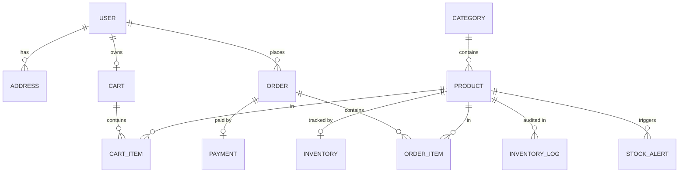

# FreshBasket: Cloud-Based Grocery Ordering & Inventory Management System

> **Tagline:** Fresh groceries. Smarter shopping.  
> **Academic Project Title:** *FreshBasket: Design and Development of a Scalable Cloud-Based Grocery Ordering and Inventory-Consistency Management System Using Amazon Web Services.*  
> **Course / Purpose:** College-Level Cloud Computing Capstone Project  
> **Target Audience:** Students, Instructors, Developers, and Beginners with Zero Prior Experience.

---

# TABLE OF CONTENTS
1. [Project Introduction](#1-project-introduction)
2. [Software Installation Guide (Windows 10/11)](#2-software-installation-guide-windows-1011)
3. [Project Setup & Virtual Environment](#3-project-setup--virtual-environment)
4. [MySQL Database Setup](#4-mysql-database-setup)
5. [Environment Configuration (.env)](#5-environment-configuration-env)
6. [Running FreshBasket Locally](#6-running-freshbasket-locally)
7. [Complete Website Walkthrough](#7-complete-website-walkthrough)
8. [The Five Core MVP Features Explained](#8-the-five-core-mvp-features-explained)
9. [Database Design & Architecture (with ER Diagram)](#9-database-design--architecture)
10. [AWS Account Setup from Absolute Zero](#10-aws-account-setup-from-absolute-zero)
11. [Complete Step-by-Step AWS Deployment](#11-complete-step-by-step-aws-deployment)
12. [Troubleshooting Common Errors](#12-troubleshooting-common-errors)
13. [Automated & Manual Testing Guide](#13-automated--manual-testing-guide)
14. [GitHub Version Control Guide](#14-github-version-control-guide)
15. [AWS Cost Management & Resource Cleanup](#15-aws-cost-management--resource-cleanup)
16. [College Viva & Evaluation Q&A (20 Questions & Answers)](#16-college-viva--evaluation-qa)

---

# 1. PROJECT INTRODUCTION

### What is FreshBasket?
**FreshBasket** is a full-stack, cloud-hosted online grocery shopping and inventory management platform. It allows everyday grocery shoppers to browse fresh food, search items, view live inventory levels, add products to their carts with customized substitution choices, and checkout securely. Simultaneously, store managers and administrators enjoy an automated, data-driven dashboard with real-time stock counters, low-stock warnings, and an immutable audit trail.

### Why Was FreshBasket Created? (The Problem It Solves)
Online grocery retail differs fundamentally from selling clothes or electronics:
1. **Perishable goods & fast movement:** Fruits, vegetables, and milk sell out rapidly.
2. **The "Overselling" Disaster:** What happens when there is only **1 packet of Milk** left on the shelf, but **two different customers** click "Place Order" at the exact same fraction of a second?
   - In poorly designed systems, both orders go through. The inventory drops to `-1` (negative stock).
   - The store cannot deliver the second order, resulting in customer frustration, emergency phone calls, refund fees, and lost brand loyalty.

### How FreshBasket Solves This
FreshBasket introduces a **transaction-safe inventory reservation engine**. When you enter the checkout process, the backend places an atomic database row lock on the item and creates a **temporary 10-minute reservation**. If another shopper attempts to buy that item, our system safely informs them that the item is currently reserved or out of stock. If the customer completes checkout, the stock is permanently deducted. If the customer abandons their cart or 10 minutes pass, the reservation automatically expires and returns the stock to the store shelf!

### The Five Core MVPs
1. **MVP 1: Transactional Inventory Reservation** – Prevents overselling using database locks (`select_for_update`) and automatic 10-minute expiry.
2. **MVP 2: Real-Time Product Availability** – Dynamically calculates available stock (`physical_stock - reserved_stock`) and shows color-coded badges (`In Stock`, `Low Stock`, `Out of Stock`).
3. **MVP 3: Automated Stock Alerts** – Instantly warns administrators when products drop below their threshold.
4. **MVP 4: Customer Substitution Preferences** – Allows shoppers to select replacement rules (*"Allow substitute"*, *"No substitute"*, or *"Specific product"*).
5. **MVP 5: Immutable Inventory Audit Ledger** – A permanent, unalterable log recording every stock addition, reservation, sale, and cancellation.

---

# 2. SOFTWARE INSTALLATION GUIDE (WINDOWS 10/11)

If you are starting on a brand-new computer, follow these installation steps.

### Step 1: Install Python (Version 3.11, 3.12, or 3.13)
1. Visit the official Python download page: [https://www.python.org/downloads/](https://www.python.org/downloads/)
2. Download the Windows installer (64-bit).
3. **CRITICAL STEP:** When running the installer, **CHECK THE BOX** at the bottom that says **"Add python.exe to PATH"**.
4. Click **Install Now**.
5. **Verify in PowerShell / CMD:**
   ```powershell
   python --version
   # Expected output: Python 3.11.x, 3.12.x, or 3.13.x
   ```

### Step 2: Install Visual Studio Code (VS Code)
1. Download VS Code for Windows: [https://code.visualstudio.com/Download](https://code.visualstudio.com/Download)
2. Run the installer and keep default options selected.
3. Open VS Code &rarr; Extensions tab (`Ctrl+Shift+X`) &rarr; Install the official **Python** extension by Microsoft.

### Step 3: Install MySQL Community Server & MySQL Workbench
*(Note: FreshBasket can also run locally on SQLite with zero setup, but for real MySQL experience:)*
1. Download MySQL Community Installer: [https://dev.mysql.com/downloads/installer/](https://dev.mysql.com/downloads/installer/)
2. Select **Custom** or **Developer Default**.
3. Ensure both **MySQL Server 8.0** and **MySQL Workbench** are selected.
4. Set a root password (for example: `root` or `Admin123!`) and **remember it**.
5. Complete installation and make sure the MySQL Windows Service starts automatically.

### Step 4: Install Git
1. Download Git for Windows: [https://git-scm.com/download/win](https://git-scm.com/download/win)
2. Run installer with standard defaults.
3. **Verify in PowerShell:**
   ```powershell
   git --version
   # Expected output: git version 2.x.x
   ```

---

# 3. PROJECT SETUP & VIRTUAL ENVIRONMENT

### What is a Virtual Environment?
A virtual environment is an isolated container on your computer containing only the Python libraries needed for FreshBasket. This prevents conflicts with other Python projects on your machine.

### Step-by-Step Instructions:
1. Open **VS Code**.
2. Click **File &rarr; Open Folder...** &rarr; Select your project folder:
   `c:\Users\<YourUsername>\Documents\Cloud Project`
3. Open the built-in terminal by pressing **Ctrl + `** (or **Terminal &rarr; New Terminal**).
4. Verify you are inside the project folder:
   ```powershell
   pwd
   # You should see: C:\Users\<YourUsername>\Documents\Cloud Project
   ```
5. Create a virtual environment named `venv`:
   ```powershell
   python -m venv venv
   ```
6. **Activate the Virtual Environment:**
   - **In Windows PowerShell:**
     ```powershell
     .\venv\Scripts\Activate.ps1
     ```
     *(If PowerShell gives a script execution policy error, run this command first: `Set-ExecutionPolicy -Scope Process -ExecutionPolicy Bypass`, then activate again).*
   - **In Windows Command Prompt (CMD):**
     ```cmd
     venv\Scripts\activate.bat
     ```
   - **Success Check:** You will now see `(venv)` at the beginning of your terminal line!

7. Install project dependencies:
   ```powershell
   pip install -r requirements.txt
   ```

---

# 4. MYSQL DATABASE SETUP

FreshBasket supports both **MySQL** (recommended for production/cloud) and **SQLite** (instant local fallback).

### If Using Local MySQL:
1. Open **MySQL Workbench**.
2. Click on your local MySQL connection and log in with your root password.
3. In the query tab, run this SQL script:
   ```sql
   -- 1. Create the database
   CREATE DATABASE IF NOT EXISTS freshbasket_db CHARACTER SET utf8mb4 COLLATE utf8mb4_unicode_ci;

   -- 2. Verify database was created
   SHOW DATABASES;
   ```
4. If you wish to create a dedicated user for FreshBasket:
   ```sql
   CREATE USER IF NOT EXISTS 'freshbasket_user'@'localhost' IDENTIFIED BY 'FreshBasketPass123!';
   GRANT ALL PRIVILEGES ON freshbasket_db.* TO 'freshbasket_user'@'localhost';
   FLUSH PRIVILEGES;
   ```

### If Using Zero-Config Local SQLite:
If you do not have MySQL installed on your laptop, FreshBasket includes an automatic fallback! You can set `DB_ENGINE=sqlite` in your `.env` file and everything will work instantly with zero database installation required.

---

# 5. ENVIRONMENT CONFIGURATION (.ENV)

### What is an Environment Variable?
An environment variable is a secret setting stored outside your source code. Keeping database passwords and secret keys in a `.env` file guarantees that your passwords are never accidentally published to public websites like GitHub.

### How to Create Your `.env` File:
1. In the root of your project, find `.env.example`.
2. Copy `.env.example` and create a new file named `.env`:
   ```powershell
   Copy-Item .env.example .env
   ```
3. Open `.env` in VS Code. Here is what it looks like:

```ini
# Django Settings
SECRET_KEY=django-insecure-freshbasket-dev-secret-key-123456
DEBUG=True
ALLOWED_HOSTS=localhost,127.0.0.1

# Database Configuration
# Options: 'sqlite' (for instant zero-install local testing) or 'mysql' (for MySQL/AWS RDS)
DB_ENGINE=sqlite

# If DB_ENGINE=mysql:
DB_NAME=freshbasket_db
DB_USER=root
DB_PASSWORD=your_mysql_password_here
DB_HOST=localhost
DB_PORT=3306

# AWS Settings (Optional locally; used in production)
USE_S3=False
USE_RDS=False
AWS_STORAGE_BUCKET_NAME=your-s3-bucket-name
AWS_S3_REGION_NAME=ap-south-1
```

> **IMPORTANT RULE:** Never commit your `.env` file to GitHub! The `.gitignore` file already includes `.env` to protect your privacy.

---

# 6. RUNNING FRESHBASKET LOCALLY

Whenever you want to start FreshBasket on your machine, open your VS Code terminal and execute these commands in order:

### 1. Run Database Migrations
Migrations set up all the database tables (Users, Products, Categories, Inventory, Orders):
```powershell
python manage.py migrate
```
*Expected output:* `Applying accounts.0001_initial... OK`, `Applying products.0001_initial... OK`, etc.

### 2. Load Sample Grocery Catalog & Inventory
Our safe seed script loads 8 grocery categories and 32 realistic products with pricing and starting inventory:
```powershell
python manage.py seed_data
```
*Expected output:* `✅ Seed data complete! 8 categories, 32 products loaded.`

### 3. Create Default Demo Accounts
Creates ready-to-use Administrator and Customer accounts for demonstration:
```powershell
python manage.py create_demo_users
```
*Expected output:*
- **Administrator:** Username: `admin` | Password: `AdminPassword123!`
- **Customer 1:** Username: `customer` | Password: `CustomerPassword123!`
- **Customer 2:** Username: `customer2` | Password: `CustomerPassword123!`

### 4. Start the Development Server
```powershell
python manage.py runserver
```
*Expected output:*
```
Starting development server at http://127.0.0.1:8000/
Quit the server with CTRL-BREAK.
```

### 5. Open in Web Browser
Open your browser (Chrome, Edge, Firefox) and navigate to:
```
http://127.0.0.1:8000/
```
You will be greeted by the live FreshBasket homepage!

### How to Stop the Server
When you are done testing, click inside the terminal and press **Ctrl + C** to safely shut down the development server.

---

# 7. COMPLETE WEBSITE WALKTHROUGH

FreshBasket features two separate experiences: the **Customer Storefront** and the **Store Administrator Portal**.

### Customer Website
| Page | URL Path | What It Does |
| :--- | :--- | :--- |
| **Home** | `/` | Fresh hero banner, category pills, featured grocery items, search bar, and "How it Works" guide. |
| **All Products** | `/products/` | Filter products by category, sort by price (Low to High / High to Low), search by keywords, view live stock badges. |
| **Product Details** | `/products/<slug>/` | Full product image, price per unit (kg, L, pack), available inventory count, quantity picker, substitute selector, and "Add to Cart" button. |
| **Register** | `/accounts/register/` | Secure customer onboarding with validation and auto-login. |
| **Login** | `/accounts/login/` | Secure session authentication with username/password check. |
| **Shopping Cart** | `/orders/cart/` | Adjust item quantities, remove items, set item-level substitution preferences, view subtotal and flat delivery fees. |
| **Checkout** | `/orders/checkout/` | Pre-fills default shipping address, lets customer choose between Cash on Delivery and Simulated Payment, confirms stock reservations atomically. |
| **Order Confirmation** | `/orders/confirmation/<id>/` | Displays order summary, invoice breakdown, unique tracking number (`#FBxxxxxxxx`), and estimated delivery. |
| **My Orders** | `/orders/my-orders/` | Historical record of past orders with colored status tags (`Pending`, `Confirmed`, `Delivered`, `Cancelled`). |
| **Order Details** | `/orders/my-orders/<id>/` | View itemized receipt and cancel eligible orders (restores inventory automatically). |
| **Customer Profile** | `/accounts/profile/` | Edit personal info and manage multiple saved shipping addresses. |

### Store Administrator Portal
*(Accessible by logging in as `admin` and clicking "Admin Dashboard" in the user menu)*

| Section | URL Path | Purpose |
| :--- | :--- | :--- |
| **Dashboard Overview** | `/dashboard/` | Real-time counters (Total Products, Orders, Revenue, Stock Levels) and interactive Chart.js graphs. |
| **Product Management** | `/dashboard/products/` | Add new grocery products, edit prices, upload images, configure alert thresholds, activate/deactivate items. |
| **Category Management**| `/dashboard/categories/`| Manage grocery categories, assign Bootstrap icons, set sort order. |
| **Inventory Manager** | `/inventory/` | View shelf physical stock, checkout reserved stock, and available stock. Button to manually restock any item. |
| **Stock Alerts** | `/inventory/alerts/` | Lists products triggering low-stock or out-of-stock conditions with an "Acknowledge" button. |
| **Audit Log Ledger** | `/inventory/log/` | Append-only ledger recording every stock transaction. Read-only to prevent tampering. |
| **Order Processing** | `/orders/admin/orders/` | View all customer orders, update delivery status (`Processing`, `Out for Delivery`, `Delivered`, `Cancelled`). |

---

# 8. THE FIVE CORE MVP FEATURES EXPLAINED

### MVP 1: Transactional Inventory Reservation
- **The Problem:** Two customers checkout the last item at the exact same second. Without locking, both orders succeed, leading to negative inventory (-1).
- **How FreshBasket Solves It:** FreshBasket wraps stock reservation in a database transaction with `select_for_update()`. This locks the row in MySQL, forces competing requests to wait in line, and grants the reservation only to the first customer.
- **Expiry:** Reservations are valid for 10 minutes. If the shopper closes their browser, the background command `python manage.py expire_reservations` cancels the reservation and returns the item to available stock.
- **Key Code File:** `inventory/services.py` &rarr; `reserve_stock()` function.

### MVP 2: Real-Time Product Availability
- **The Formula:**  
  $$\text{Available Stock} = \text{Physical Warehouse Stock} - \text{Active Reserved Stock}$$
- **Color-Coded Badges:**
  - `In Stock` (Green): Available units exceed threshold.
  - `Low Stock` (Yellow): Available units are between 1 and threshold.
  - `Out of Stock` (Red): Available units equal 0 (purchase button automatically disabled).
- **Key Code File:** `inventory/models.py` &rarr; `Inventory.available_stock` property.

### MVP 3: Low-Stock & Out-of-Stock Alerts
- **How It Works:** Every product has a customizable `low_stock_threshold` (e.g. 10 units for Milk, 5 units for Butter). When available stock dips below this number, the backend automatically logs an unacknowledged `StockAlert`.
- **Deduplication:** FreshBasket checks if an unacknowledged alert already exists, preventing spamming the dashboard with duplicate notifications.
- **Key Code File:** `inventory/services.py` &rarr; `_check_and_create_alert()` function.

### MVP 4: Customer Substitution Preferences
- **The Problem:** In grocery delivery, a specific brand (e.g. *Amul Full Cream Milk*) might run out at the packing station.
- **The Solution:** During cart review, customers can choose:
  1. *Do not substitute* (Item is refunded if missing).
  2. *Allow suitable substitute* (Store picks a similar product like *Mother Dairy Toned Milk*).
- **Key Code File:** `orders/models.py` &rarr; `CartItem.substitution_preference` field.

### MVP 5: Immutable Inventory Audit Ledger
- **Why It Matters:** Store owners must know where every single grocery item went.
- **Implementation:** Every time stock is added (restock), reserved (cart), sold (checkout), or returned (order cancellation), an `InventoryLog` is recorded with timestamp, quantity change, actor, and before/after levels.
- **Security:** The Django Admin forbids editing or deleting audit log records.
- **Key Code File:** `inventory/models.py` &rarr; `InventoryLog` model.

---

# 9. DATABASE DESIGN & ARCHITECTURE

FreshBasket uses a normalized relational database design.

### Mermaid Entity-Relationship (ER) Diagram:


### Detailed Table Specifications:
- `auth_user_extended`: Custom user table supporting customer and admin roles.
- `customer_address`: Multiple delivery addresses per user with default flags.
- `product_category`: Hierarchical categories with icon names and sort orders.
- `product`: Stores title, price, unit type (kg, L, pcs), description, image, and threshold.
- `inventory`: One-to-one record holding `physical_stock`, `reserved_stock`, and `stock_status`.
- `stock_reservation`: 10-minute temporary holds linked to customers and products.
- `inventory_log`: Permanent audit trail of all historical inventory movements.
- `cart` & `cart_item`: Active shopping baskets with substitution preferences.
- `order` & `order_item`: Placed customer orders with price snapshots.
- `stock_alert`: Notifications for store managers when stock is running low.

---

# 10. AWS ACCOUNT SETUP FROM ABSOLUTE ZERO

If you have never used Amazon Web Services before, follow this beginner walkthrough:

### 1. Create Your AWS Account
1. Visit [https://aws.amazon.com/free/](https://aws.amazon.com/free/).
2. Click **Create a Free Account**.
3. Enter your email and account name &rarr; Complete identity verification with your debit/credit card (AWS charges a temporary \$1 or ₹2 verification amount which is refunded).

### 2. Secure Your Root Account
1. After signing in, search for **IAM** in the top search bar.
2. Under "Security recommendations", click **Add MFA (Multi-Factor Authentication)**.
3. Use Google Authenticator on your phone to scan the QR code. This secures your cloud account against hackers.

### 3. Setup a Zero-Dollar / Low-Budget Alert
1. In the search bar, type **Billing and Cost Management**.
2. Click **Budgets** in the left menu &rarr; Click **Create budget**.
3. Choose **Zero spend budget** (or enter \$1.00 monthly threshold).
4. Enter your email address. AWS will instantly email you if you ever incur an unexpected charge.

### 4. Select Your AWS Region
At the top-right corner of the AWS console, click the region dropdown and select **Asia Pacific (Mumbai) `ap-south-1`** (or the region closest to your college).

---

# 11. COMPLETE STEP-BY-STEP AWS DEPLOYMENT

For a complete, copy-paste-ready deployment manual, please refer to our dedicated guide:  
👉 **[Read the Full AWS Deployment Manual (AWS_DEPLOYMENT.md)](AWS_DEPLOYMENT.md)**

### Deployment Summary:
1. **Amazon S3:** Bucket created for uploaded product images with public read policies.
2. **AWS IAM:** EC2 Instance Role with `AmazonS3FullAccess` and `CloudWatchAgentServerPolicy`.
3. **Amazon RDS:** Managed MySQL 8.0 instance placed in private subnet with no public IP.
4. **Amazon EC2:** Ubuntu 24.04 LTS instance running Nginx (port 80 reverse proxy) and Gunicorn application server.
5. **Automation:** Linux systemd services and crontab for automatic reservation expiry.

---

# 12. TROUBLESHOOTING COMMON ERRORS

### Error 1: "python is not recognized as an internal or external command"
- **Why it happens:** Python was installed without checking the "Add python.exe to PATH" checkbox.
- **Solution:** Re-run the Python Windows installer, select **Modify**, and make sure **Add Python to Environment Variables** is checked.

### Error 2: "Execution of scripts is disabled on this system"
- **Why it happens:** Windows PowerShell security policy blocks virtual environment activation.
- **Solution:** Run this command in PowerShell:
  ```powershell
  Set-ExecutionPolicy -Scope Process -ExecutionPolicy Bypass
  .\venv\Scripts\Activate.ps1
  ```

### Error 3: "Port 8000 is already in use"
- **Why it happens:** A previous Django server is still running in the background.
- **Solution:** Start the server on a different port:
  ```powershell
  python manage.py runserver 8080
  ```
  Then visit `http://127.0.0.1:8080/`.

### Error 4: "Can't connect to MySQL server on 'localhost'"
- **Why it happens:** MySQL Windows service is stopped or not installed.
- **Solution:** Either start the MySQL service in Windows Services (`services.msc`), or simply switch `DB_ENGINE=sqlite` in your `.env` file to use SQLite immediately.

### Error 5: "Static files (CSS / images) not loading in production"
- **Why it happens:** Django does not serve static files directly when `DEBUG=False`.
- **Solution:** Run `python manage.py collectstatic --noinput` and ensure Nginx is configured with `location /static/ { root /home/ubuntu/FreshBasket; }`.

---

# 13. AUTOMATED & MANUAL TESTING GUIDE

### Running Automated Django Tests:
```powershell
python manage.py test
```
*Expected Output:*
```
Ran 8 tests in 9.500s
OK
```

### Manual Testing Scenarios (Viva Ready):
1. **The Concurrency Test:** Open two browser windows (Chrome and Chrome Incognito). Place 1 item in stock. Have both users submit checkout. Verify only ONE succeeds and the other gets an out-of-stock notification.
2. **Alert Trigger Test:** Place an order that reduces a product's stock below its threshold. Log into `/dashboard/` &rarr; verify the low-stock alert appears in the alert panel.
3. **Cancellation Test:** Cancel an order from `/orders/my-orders/`. Verify in `/inventory/` that the stock counter increments back up immediately.

👉 **[See Full Testing Documentation in TESTING.md](TESTING.md)**

---

# 14. GITHUB VERSION CONTROL GUIDE

### 1. Initialize Git in the Project:
```powershell
git init
git add .
git commit -m "Initial commit: FreshBasket complete full-stack cloud project"
```

### 2. Push to Your GitHub Account:
1. Create a new repository on [GitHub](https://github.com/new) named `FreshBasket` (select **Public** or **Private**, do not initialize with README).
2. Connect and push your code:
   ```powershell
   git remote add origin https://github.com/<YOUR-USERNAME>/FreshBasket.git
   git branch -M main
   git push -u origin main
   ```

> **Security Reminder:** Your `.gitignore` file already prevents `.env` and `db.sqlite3` from being uploaded. Always verify that your personal passwords are not pushed.

---

# 15. AWS COST MANAGEMENT & RESOURCE CLEANUP

To avoid unnecessary cloud bills after your college demonstration is complete:
1. **Terminate EC2 Instance:** Go to EC2 &rarr; Select `FreshBasket-WebServer` &rarr; Instance State &rarr; **Terminate instance**.
2. **Delete RDS Database:** Go to RDS &rarr; Select `freshbasket-db` &rarr; Actions &rarr; **Delete** (uncheck *Create final snapshot*).
3. **Empty & Delete S3 Bucket:** Go to S3 &rarr; Select your bucket &rarr; Click **Empty** &rarr; Then click **Delete**.
4. **Release Elastic IP:** Under EC2 &rarr; Elastic IPs &rarr; Release Elastic IP address.

---

# 16. COLLEGE VIVA & EVALUATION Q&A

Here are 20 likely viva questions your professor might ask, with clear beginner-friendly answers:

#### Q1: What is the main innovation of FreshBasket?
**Answer:** The primary innovation is **transaction-safe inventory reservation**. In standard eCommerce sites, concurrent checkouts cause overselling. FreshBasket locks database rows using `select_for_update()` during checkout to guarantee that two customers cannot purchase the last unit simultaneously.

#### Q2: What is the difference between physical stock and available stock?
**Answer:** Physical stock is the actual number of products physically on the shelf. Available stock equals physical stock minus reserved stock currently held in active checkouts.

#### Q3: Why did you choose Django for the backend?
**Answer:** Django is a robust, secure Python framework that includes built-in authentication, an Object-Relational Mapper (ORM), transaction control, CSRF protection, and administrative interfaces out of the box.

#### Q4: What is an ORM and why did you use it?
**Answer:** ORM stands for Object-Relational Mapping. It allows developers to interact with the database using Python classes and methods instead of writing raw SQL strings, protecting against SQL injection attacks.

#### Q5: What is the purpose of `select_for_update()`?
**Answer:** It applies a row-level lock in the SQL database. When a transaction accesses an inventory row, other transactions attempting to update that same row must wait until the first transaction commits or rolls back.

#### Q6: How do expired reservations get released?
**Answer:** Every reservation has an `expires_at` timestamp (10 minutes). A periodic management command (`python manage.py expire_reservations`) runs and automatically restores expired reservations to the available stock pool.

#### Q7: Why do you store delivery address in the `Order` table instead of just linking to the `Address` table?
**Answer:** For data snapshotting. If a customer later edits or deletes their saved home address, the historical delivery record on past invoices must remain unchanged.

#### Q8: What AWS services does FreshBasket use?
**Answer:** Amazon EC2 (computing and hosting), Amazon RDS (managed MySQL database), Amazon S3 (product image media storage), AWS IAM (security roles), and Amazon CloudWatch (logging and monitoring).

#### Q9: Why is the RDS database placed in a private subnet?
**Answer:** For security. By giving RDS no public IP address and placing it in a private subnet, hackers on the public Internet cannot reach our database directly; only our EC2 web server can communicate with it.

#### Q10: How does EC2 authenticate with Amazon S3?
**Answer:** We use an **IAM Instance Role** attached to EC2 rather than hardcoding AWS Access Keys in source files.

#### Q11: What is Nginx and why is it needed alongside Gunicorn?
**Answer:** Gunicorn is a WSGI application server that executes Python code. Nginx is a high-performance reverse proxy that sits in front of Gunicorn to handle SSL termination, serve static files, and protect Gunicorn from slow-client attacks.

#### Q12: How does the Low-Stock alert system prevent alert spam?
**Answer:** FreshBasket checks if an unacknowledged alert for that product already exists. If one exists, it skips creating duplicates until the administrator acknowledges the existing alert.

#### Q13: What happens when an order is cancelled?
**Answer:** The system checks if the order is eligible for cancellation (`Pending` or `Confirmed`), changes the status to `Cancelled`, and runs `restore_stock_on_cancellation()` to return the units to physical inventory while logging the event in the audit ledger.

#### Q14: What is the purpose of the Inventory Audit Log?
**Answer:** It provides full accountability and transparency. Every single stock movement (restock, sale, reservation, release, cancellation) is permanently recorded with timestamps, user responsible, and quantity change.

#### Q15: Can an administrator delete or edit records in the Audit Log?
**Answer:** No. In `inventory/admin.py`, permissions for `has_delete_permission` and `has_change_permission` are set to `False`, making the ledger strictly append-only.

#### Q16: How do customer substitution preferences work?
**Answer:** Customers can specify whether they allow store staff to substitute an unavailable grocery item with an alternative brand, avoiding full order cancellation during fulfillment.

#### Q17: What is CSRF and how is FreshBasket protected against it?
**Answer:** Cross-Site Request Forgery occurs when a malicious site tricks a browser into executing unauthorized commands on a trusted site. FreshBasket uses Django's `` on every POST form to validate authenticity.

#### Q18: What is WhiteNoise?
**Answer:** WhiteNoise allows a Python web application to serve its own static files (CSS, JS, images) in production without relying on complex web server configurations.

#### Q19: How did you test concurrency?
**Answer:** We wrote automated tests using Python's `threading` library (`test_two_users_competing_sequential` and concurrent simulations in `inventory/tests.py`) where competing requests targeted the last available unit of stock.

#### Q20: What are the main limitations and future scope of FreshBasket?
**Answer:** Currently, FreshBasket is optimized for a single grocery store. Future scope includes multi-store warehouse routing, real-time customer push updates via WebSockets, and AI-powered replenishment forecasting.

---

### Additional Documentation Files in This Repository:
- 📖 **[ARCHITECTURE.md](ARCHITECTURE.md)**: Detailed system, network, and sequence diagrams.
- 🗄️ **[DATABASE_DESIGN.md](DATABASE_DESIGN.md)**: Database schemas and full Mermaid ER diagram.
- ☁️ **[AWS_DEPLOYMENT.md](AWS_DEPLOYMENT.md)**: Copy-paste AWS production manual.
- 🧪 **[TESTING.md](TESTING.md)**: Test plan, automated results, and manual scenarios.
- 🎓 **[DEMO_GUIDE.md](DEMO_GUIDE.md)**: Script and presentation checklist for college evaluations.
- 📚 **[GLOSSARY.md](GLOSSARY.md)**: Plain-English dictionary of technical terms.
- 📄 **[PROJECT_REPORT.md](PROJECT_REPORT.md)**: Formal academic project documentation.

